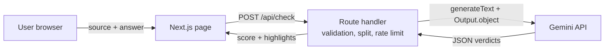

# Hallucination Detector

Paste a **source text** and an **AI answer**. The app splits the answer into sentences and asks a model to label each one as **supported**, **not supported**, or **contradicted** by the source. You get an overall groundedness score, a colour-coded highlight of the answer, a short reason for every sentence, and a supporting quote when the claim is grounded.

**Live demo:** https://hallucination-detector-five.vercel.app

## Features

- Sentence-level labels: supported, not supported, or contradicted
- Groundedness score (percentage of supported sentences)
- Colour-coded highlighted answer, with reasons and source quotes
- Three ready-made examples you can run in one click
- Structured JSON output validated with Zod
- Input length limits, a sentence cap, and a basic per-IP rate limit on the API route
- Graceful error if the model call fails
- Nothing is stored: the source and answer are sent only to produce the labels, then discarded

## How it works

1. The browser sends the source and the answer to `POST /api/check`.
2. The server validates the input, splits the answer into sentences, and calls Gemini with a structured-output schema.
3. Each sentence is labelled against the source only. The model is told not to use outside knowledge and to ignore instructions inside the pasted text.
4. The response includes the sentences (with character offsets), the verdicts, and the groundedness score.



## Privacy

Texts are not written to a database and are not logged on purpose. They are sent to the Gemini API to produce the labels and are not kept by this app afterwards.

## Evaluation

A small labelled suite of 10 synthetic cases (26 sentences) lives in [`evals/`](evals/). `npm run eval` calls the same `checkAnswer` helper as the API and compares each predicted label with the gold label.

**One run of `gemini-3.5-flash-lite` scored 92.3% (24/26 sentence labels).** The two misses are in a case where the model marked invented claims as contradicted rather than not supported. Full per-case numbers are in [`evals/results.md`](evals/results.md). This is a smoke check, not a general benchmark.

## Tech stack

- [Next.js](https://nextjs.org) (App Router) + TypeScript
- [Tailwind CSS](https://tailwindcss.com)
- [AI SDK](https://ai-sdk.dev) (`generateText` with `Output.object`) and [Zod](https://zod.dev)
- [Google Gemini API](https://ai.google.dev) via `@ai-sdk/google` (`gemini-3.5-flash-lite` by default)
- [Vitest](https://vitest.dev) for unit tests
- Deployed on [Vercel](https://vercel.com)

## Tests and CI

`npm test` runs unit tests for sentence splitting, score computation, schema parsing, input validation, verdict alignment, the rate limiter, and the API route with a mocked model. GitHub Actions ([`.github/workflows/ci.yml`](.github/workflows/ci.yml)) runs the type check, the tests and the production build. The CI job does not need an API key.

## API

`POST /api/check` with `{ "source": "...", "answer": "..." }` returns:

```json
{
  "sentences": [{ "text": "The tower was completed in 1889.", "start": 0, "end": 33 }],
  "verdicts": [
    {
      "index": 0,
      "sentence": "The tower was completed in 1889.",
      "label": "supported",
      "reason": "The source states the completion year.",
      "quote": "completed in 1889"
    }
  ],
  "score": {
    "supported": 1,
    "notSupported": 0,
    "contradicted": 0,
    "total": 1,
    "groundedness": 100
  },
  "model": "gemini-3.5-flash-lite"
}
```

Limits: source 8,000 characters, answer 4,000 characters, at most 40 sentences. The route also rejects oversized bodies and rate-limits repeated requests from the same IP.

## Run locally

Requires Node.js 22+. Clone the repository, run `npm install`, and create a `.env.local` file (never commit it) with:

```bash
GOOGLE_GENERATIVE_AI_API_KEY=your_gemini_api_key
```

Then run `npm run dev` and open [http://localhost:3000](http://localhost:3000). Use `npm test` for the unit tests and `npm run eval` to run the labelled suite against the live model. You can change the model with `GOOGLE_MODEL`.

## License

[MIT](LICENSE)
